<div align="center">

# 🧠 Deep Learning Practical Exam — Set A

### Five standalone mini-projects across **tabular 📊 · image 🖼️ · sequence 📈 · text 💬** data

<p>
  
  
  
  
  
</p>
<p>
  
  
  
  
</p>

**👤 Author: Krisha Anghan**

</div>

---

## 📑 Table of Contents

- [✨ Overview](#-overview)
- [🏆 Results at a Glance](#-results-at-a-glance)
- [1️⃣ ANN — Diabetes Prediction](#1️⃣-ann--diabetes-prediction)
- [2️⃣ OpenCV — Image Preprocessing Pipeline](#2️⃣-opencv--image-preprocessing-pipeline)
- [3️⃣ CNN — CIFAR-10 Classification](#3️⃣-cnn--cifar-10-classification)
- [4️⃣ RNN — Airline Passenger Forecasting](#4️⃣-rnn--airline-passenger-forecasting)
- [5️⃣ Transformer — Sentiment Analysis](#5️⃣-transformer--sentiment-analysis)
- [💡 Key Learnings](#-key-learnings)
- [🚧 Challenges](#-challenges)
- [🔮 Future Work](#-future-work)
- [📂 Project Structure](#-project-structure)
- [⚙️ Installation & Usage](#️-installation--usage)
- [🔗 Resources](#-resources)

---

## ✨ Overview

This repository contains my **Deep Learning Practical Exam (Set A)**. It covers the **full ML workflow** — loading data ➜ preprocessing ➜ building ➜ training ➜ evaluating ➜ saving models — across four data types:

| # | 🎯 Task | 🧩 Technique | 📦 Dataset |
|:-:|---|---|---|
| 1️⃣ | Diabetes prediction | **ANN** (Keras) | [Pima Indians Diabetes](https://www.kaggle.com/datasets/uciml/pima-indians-diabetes-database) — 768 patients, 8 features |
| 2️⃣ | Image preprocessing | **OpenCV** | [Flowers Recognition](https://www.kaggle.com/datasets/alxmamaev/flowers-recognition) — 5 images |
| 3️⃣ | Image classification | **CNN** (Keras) | [CIFAR-10](https://www.cs.toronto.edu/~kriz/cifar.html) — 20,000 train / 4,000 test |
| 4️⃣ | Time-series forecasting | **SimpleRNN** (Keras) | Airline Passengers — 144 months |
| 5️⃣ | Sentiment analysis | **DistilBERT** (Hugging Face) | 25 self-written movie reviews |

---

## 🏆 Results at a Glance

| Task | Metric | Result | 🎯 Target |
|:-:|:-:|:-:|:-:|
| 🩺 **ANN** | Test Accuracy | **70.78%** | 70–80% ✅ |
| 🌸 **OpenCV** | Pipeline | **5 images × 6 outputs** | Complete ✅ |
| 🚗 **CNN** | Test Accuracy | **64.40%** | 55–70% ✅ |
| ✈️ **RNN** | Test RMSE | **40.23 passengers** | Series ranges ~100–600 ✅ |
| 🎬 **Transformer** | Accuracy (clear reviews) | **19 / 20 = 95%** | ✅ |

---

## 1️⃣ ANN — Diabetes Prediction

> 🩺 Predicts whether a patient has diabetes from 8 medical features.

### 🔧 Pipeline
1. 📥 Load the Pima Indians Diabetes dataset (768 rows, 8 features)
2. 🧹 Replace physiologically impossible **zero values** (`Glucose`, `BloodPressure`, `SkinThickness`, `Insulin`, `BMI`) with **column medians**
3. 📏 Standardise features with `StandardScaler`
4. ✂️ Stratified **80/20** train–test split
5. 🏗️ Train for 50 epochs (batch size 32, 20% validation split)

### 🏛️ Architecture
```
Input (8) ➜ Dense(16, ReLU) ➜ Dense(8, ReLU) ➜ Dense(1, Sigmoid)
Optimizer: Adam  |  Loss: Binary Crossentropy
```

### 📊 Results
| Metric | Score |
|:-:|:-:|
| ✅ Accuracy | **70.78%** |
| 🎯 Precision | 0.58 |
| 🔁 Recall | 0.63 |
| ⚖️ F1-Score | 0.60 |

<div align="center">

| 📈 Accuracy Curve | 📉 Loss Curve |
|:-:|:-:|
| 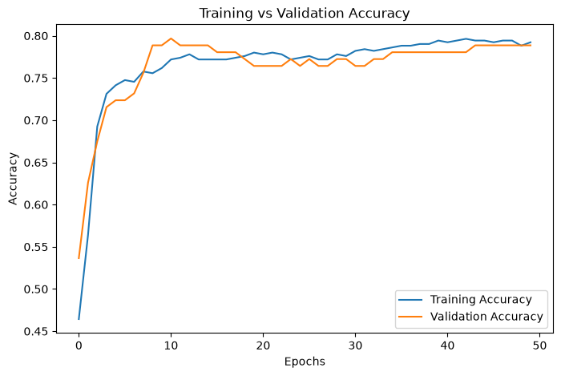 | 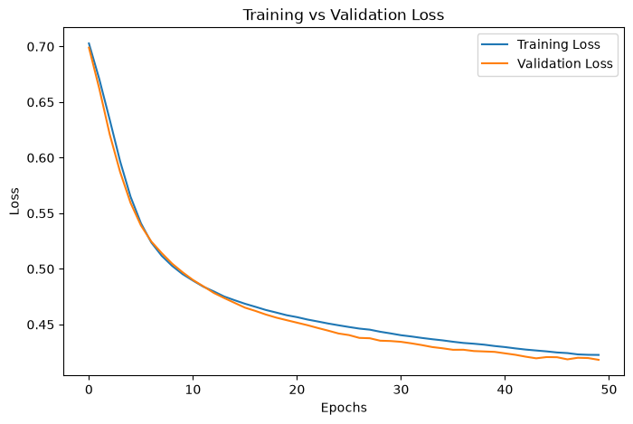 |

**🧮 Confusion Matrix** — 75 TN · 34 TP · 25 FP · 20 FN

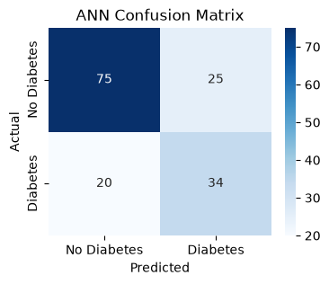

</div>

💾 **Saved model:** [`ann_diabetes_model.h5`](ann_diabetes_model.h5)

---

## 2️⃣ OpenCV — Image Preprocessing Pipeline

> 🌼 A classic computer-vision pipeline applied to 5 flower images (daisy, dandelion, rose, sunflower, tulip).

### 🔧 Steps
| Step | 🛠️ Operation | 💡 Why it matters before a CNN |
|:-:|---|---|
| 1 | **BGR ➜ RGB** conversion | OpenCV loads BGR; RGB gives correct colours |
| 2 | **Resize** to 128×128 | Uniform input size |
| 3 | **Grayscale** | Reduces channels, keeps structure |
| 4 | **Gaussian Blur** (5×5) | Removes noise |
| 5 | **Canny Edges** (100, 200) | Highlights object boundaries |
| 6 | **Largest Contour** + bounding box 🟩 | Localises the main object |

<div align="center">

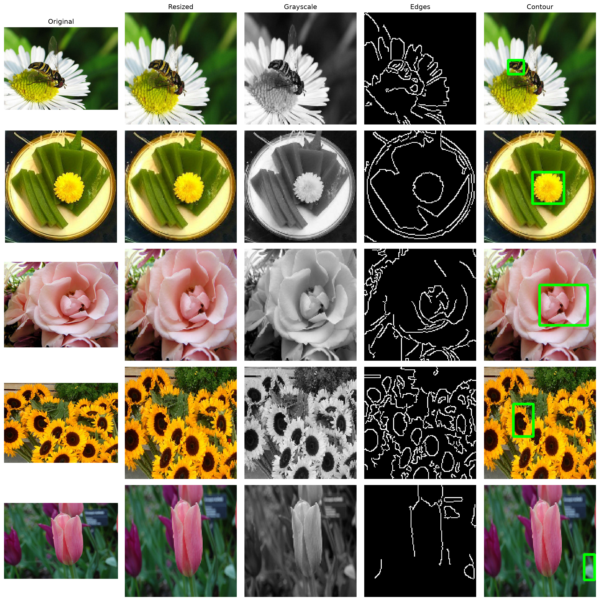

*Original ➜ Resized ➜ Grayscale ➜ Edges ➜ Contour*

</div>

---

## 3️⃣ CNN — CIFAR-10 Classification

> 🚗 Classifies 32×32 colour images into **10 classes**.

### 🏛️ Architecture
```
Conv2D(32, 3×3, ReLU) ➜ MaxPool(2×2)
Conv2D(64, 3×3, ReLU) ➜ MaxPool(2×2)
Flatten ➜ Dense(64, ReLU) ➜ Dense(10, Softmax)
Optimizer: Adam  |  Loss: Categorical Crossentropy  |  Epochs: 10  |  Batch: 64
```

### 📊 Results
- 🎯 **Test accuracy: 64.40%** (target 55–70%)
- 🏅 **Best classes:** Automobile 🚗 · Ship 🚢 · Frog 🐸
- 😿 **Hardest classes:** Cat 🐱 · Bird 🐦 · Dog 🐶

<div align="center">

| 📈 Accuracy Curve | 📉 Loss Curve |
|:-:|:-:|
| 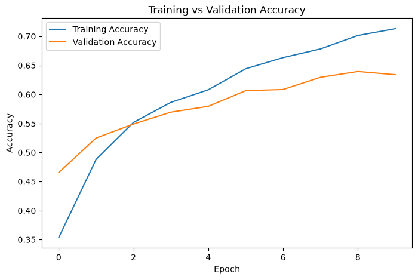 | 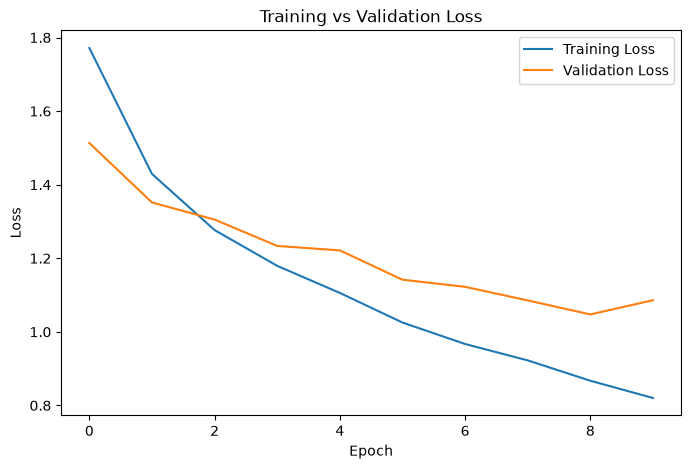 |

**🔍 Sample Predictions** (green = correct ✅, red = wrong ❌)

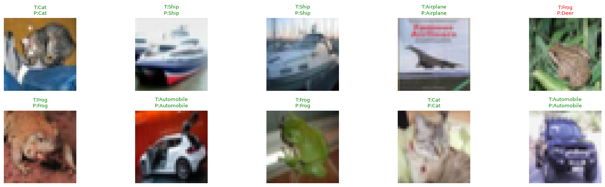

</div>

💾 **Saved model:** [`cnn_cifar10_model.h5`](cnn_cifar10_model.h5)

---

## 4️⃣ RNN — Airline Passenger Forecasting

> ✈️ Predicts next month's passengers from the **previous 12 months**.

### 🔧 Pipeline
1. 📏 Normalise with `MinMaxScaler`
2. 🪟 Sliding window — `look_back = 12`
3. ✂️ **Chronological** split (⚠️ never shuffle time-series!)
4. 🏗️ Train `SimpleRNN(50, tanh) ➜ Dense(1)` — 50 epochs, batch 16, MSE loss

### 📊 Result
🎯 **Test RMSE = 40.23 passengers** on a series ranging from ~100 to ~600.

<div align="center">

| 📈 Monthly Passengers | 📉 Training Loss |
|:-:|:-:|
| 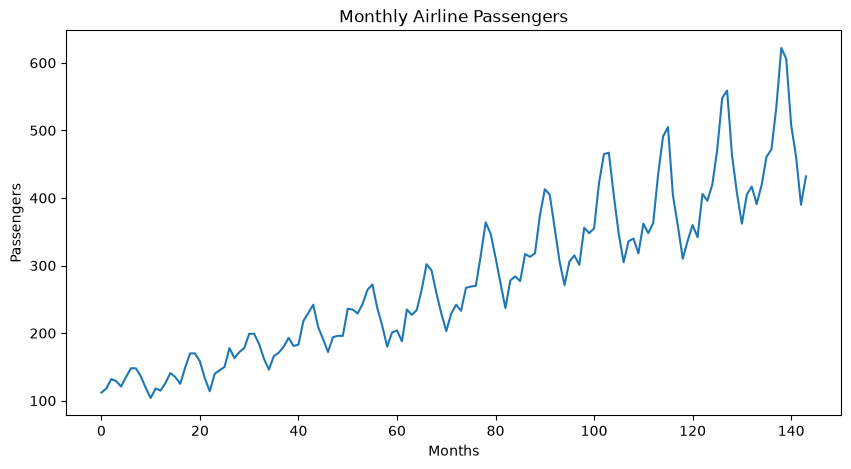 | 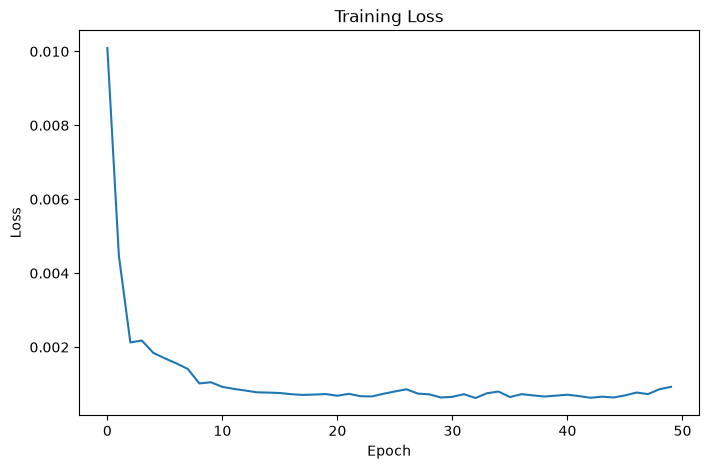 |

**🔮 Actual vs Predicted**

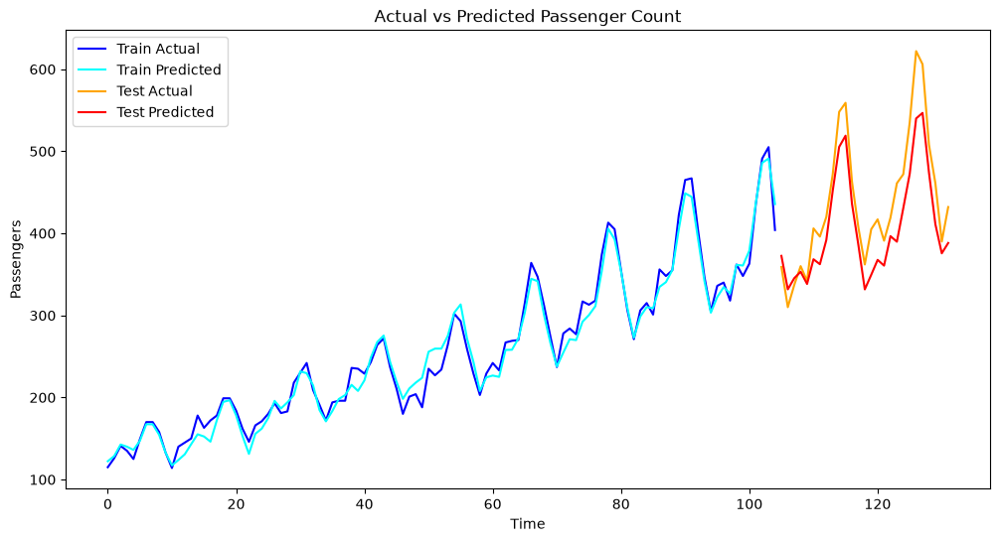

</div>

💾 **Saved model:** [`rnn_airline_model.h5`](rnn_airline_model.h5)

---

## 5️⃣ Transformer — Sentiment Analysis

> 🎬 Uses the pre-trained [`distilbert-base-uncased-finetuned-sst-2-english`](https://huggingface.co/distilbert-base-uncased-finetuned-sst-2-english) model through the Hugging Face `pipeline` — **no training required**.

```python
from transformers import pipeline

classifier = pipeline(
    "sentiment-analysis",
    model="distilbert-base-uncased-finetuned-sst-2-english"
)
classifier("This movie was absolutely fantastic!")
```

### 📊 Results
- ✅ **19 / 20 clear reviews correct (95%)**
- ❌ Only mistake: *"I would never recommend this movie"* — the model ignored the negation.

### ⚠️ Observed Weaknesses
| Issue | Detail |
|---|---|
| 🔀 Binary only | Must choose positive/negative even for neutral text |
| 📢 Overconfident | Confidence often **> 0.98** on ambiguous text |
| 🇮🇳 Indian-English slang | *"Paisa vasool movie"* (= worth the money) was confidently misclassified |

<div align="center">

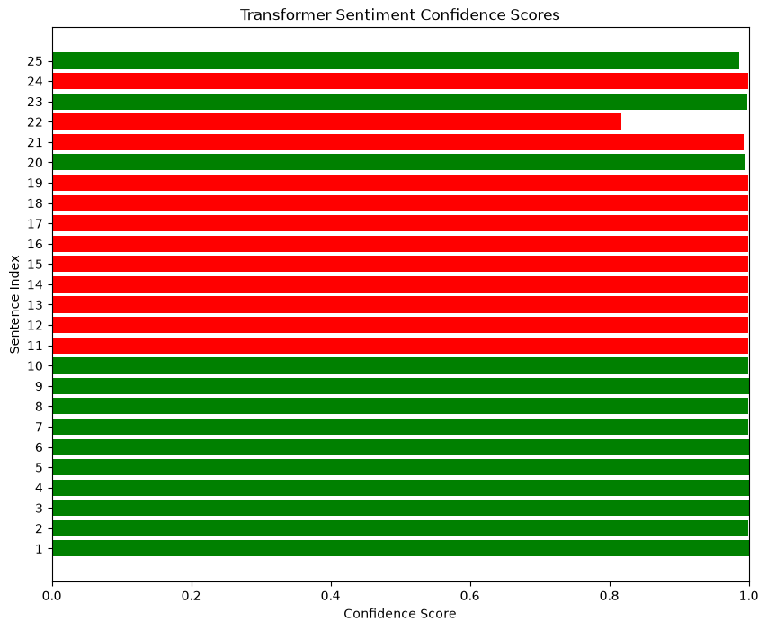

*🟩 Positive · 🟥 Negative — confidence per review*

</div>

---

## 💡 Key Learnings

- 🤖 A **pre-trained Transformer** can be used out-of-the-box — but it has real blind spots (negation, neutral text, code-mixed language).
- ⏳ **Time-series must never be shuffled** — order carries the signal.
- 👁️ OpenCV steps (blur, edges) mirror the **low-level features a CNN learns on its own**.
- 🧼 **Data cleaning matters** — fixing impossible zeros in the ANN dataset was essential.

## 🚧 Challenges

- 🐢 The **CNN** was the hardest step — longest training time and careful architecture choices.
- 🧹 The **ANN** required median imputation of invalid zeros before training.

---

## 🔮 Future Work

- [ ] 🩺 **ANN:** add Dropout, early stopping and class weighting (recall matters most in medicine)
- [ ] 🚗 **CNN:** data augmentation, batch normalisation, more epochs, the full 50,000 images, or transfer learning (e.g. **MobileNet**) — then deploy with **FastAPI / Streamlit**
- [ ] ✈️ **RNN:** replace SimpleRNN with an **LSTM** and compare RMSE
- [ ] 🌍 **Transformer:** fine-tune a **multilingual model** (XLM-R / MuRIL) on Hindi-English and Gujarati-English reviews

---

## 📂 Project Structure

```
📦 Practical-Exam
 ┣ 📓 DeepLearning_Practical_Exam_SetA.ipynb   # Main notebook (all 5 tasks)
 ┣ 📄 summary_report.md                        # Written reflection
 ┣ 📄 requirements.txt                         # Dependencies
 ┣ 📊 pima-indians-diabetes.csv                # ANN dataset
 ┣ 📊 airline-passengers.csv                   # RNN dataset
 ┣ 🧠 ann_diabetes_model.h5                    # Saved ANN
 ┣ 🧠 cnn_cifar10_model.h5                     # Saved CNN
 ┣ 🧠 rnn_airline_model.h5                     # Saved RNN
 ┗ 📁 outputs/                                 # Plots & generated images
    ┣ 🖼️ ann_*.png        (accuracy, loss, confusion matrix)
    ┣ 🖼️ cnn_*.png        (accuracy, loss, predictions)
    ┣ 🖼️ rnn_*.png        (timeseries, training loss, actual vs predicted)
    ┣ 🖼️ img1–5_*.png     (OpenCV step-by-step outputs)
    ┣ 🖼️ opencv_preprocessing_summary.png
    ┗ 🖼️ transformer_confidence_bar.png
```

---

## ⚙️ Installation & Usage

```bash
# 1️⃣ Clone the repository
git clone https://github.com/<your-username>/<your-repo-name>.git
cd <your-repo-name>

# 2️⃣ (Optional) Create a virtual environment
python -m venv venv
venv\Scripts\activate        # Windows
# source venv/bin/activate   # macOS / Linux

# 3️⃣ Install dependencies
pip install -r requirements.txt

# 4️⃣ Launch the notebook
jupyter notebook DeepLearning_Practical_Exam_SetA.ipynb
```

> 📝 **Note:** Update the dataset paths in the notebook (e.g. `D:\DL\Practical Exam\...`) to match your local folders.

### 🔁 Load a saved model
```python
from tensorflow.keras.models import load_model

ann = load_model("ann_diabetes_model.h5")
cnn = load_model("cnn_cifar10_model.h5")
rnn = load_model("rnn_airline_model.h5")
```

### 📦 Requirements
`tensorflow` · `keras` · `opencv-python` · `transformers` · `torch` · `pandas` · `numpy` · `matplotlib` · `seaborn` · `scikit-learn`

---

## 🎥 Project Video Explanation

📺 Watch the complete project explanation here:

https://drive.google.com/file/d/1jFVWE5voH53PmtiNlfsf3PW3VDbNyDee/view?usp=sharing

---


## 🔗 Resources

| 🏷️ Resource | 🔗 Link |
|---|---|
| 🩺 Pima Indians Diabetes Dataset | [Kaggle](https://www.kaggle.com/datasets/uciml/pima-indians-diabetes-database) |
| 🌸 Flowers Recognition Dataset | [Kaggle](https://www.kaggle.com/datasets/alxmamaev/flowers-recognition) |
| 🚗 CIFAR-10 Dataset | [University of Toronto](https://www.cs.toronto.edu/~kriz/cifar.html) |
| 🤗 DistilBERT SST-2 Model | [Hugging Face](https://huggingface.co/distilbert-base-uncased-finetuned-sst-2-english) |
| 🧠 TensorFlow / Keras | [tensorflow.org](https://www.tensorflow.org/) · [keras.io](https://keras.io/) |
| 👁️ OpenCV | [opencv.org](https://opencv.org/) |

---

<div align="center">

### 🙌 Thanks for visiting!

Made with ❤️ and lots of ☕ by **Krisha Anghan**


</div>
